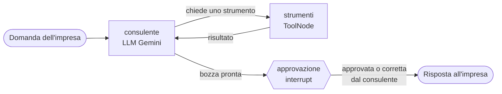
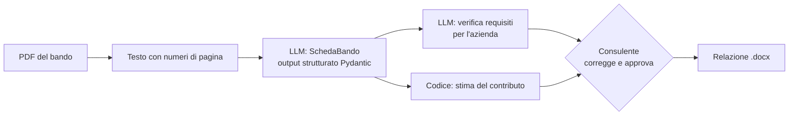

# 💶 Agente AI per la Finanza Agevolata

[](https://github.com/Micene22/agente-finanza-agevolata/actions/workflows/tests.yml)

Agente AI che aiuta uno studio di consulenza a rispondere alle imprese che chiedono
quali **bandi e contributi a fondo perduto** possono ottenere.
L'agente cerca i bandi compatibili, calcola i contributi e crea promemoria sulle scadenze,
ma **nessuna risposta arriva all'impresa senza l'approvazione di un consulente** (human-in-the-loop).

**Novità (MVP): analisi di bandi reali.** Si carica il PDF di un avviso pubblico, l'AI compila una
scheda strutturata (requisiti con articolo e pagina, spese ammissibili, agevolazione, scadenza),
verifica i requisiti per un'azienda e prepara una **relazione di pre-fattibilità in Word**,
che il consulente corregge e approva prima di scaricarla.

> ⚠️ **Progetto dimostrativo.** Non è una consulenza reale: ogni analisi va verificata da un consulente
> sul testo integrale del bando. La chat usa bandi inventati e calcoli semplificati.

## Il problema

Gli studi di consulenza passano molte ore a rispondere a richieste ripetitive
("che bandi ci sono per la mia azienda?", "quanto posso ottenere?") e rischiano di
perdere bandi in scadenza. Un chatbot generico però può inventarsi requisiti o importi.

## La soluzione: l'LLM decide, il codice calcola, l'umano approva

- **L'LLM (Gemini)** capisce la richiesta in linguaggio naturale e decide quali strumenti usare.
- **Gli strumenti** sono codice Python deterministico e testabile: requisiti, percentuali,
  massimali e urgenza non vengono mai "stimati" dal modello.
- **Il consulente** legge ogni bozza e può approvarla o correggerla prima dell'invio.
  L'approvazione è garantita dalla struttura del grafo, non dal prompt.

## Architettura



| Strumento | Cosa fa | Tipo |
|---|---|---|
| `cerca_bandi` | trova i bandi aperti compatibili con regione, dimensione e settore; segnala quelli urgenti | sola lettura |
| `calcola_contributo` | calcola il contributo (percentuale, spesa minima, massimale, scadenza) | sola lettura |
| `crea_promemoria` | registra una scadenza nell'agenda dello studio | azione |

**Tecnologie:** Python · LangGraph (grafo, checkpointer, `interrupt`) · LangChain (tool calling) ·
Gemini API · Streamlit

## Analisi di un bando reale



- **Output strutturato:** Gemini risponde riempiendo modelli Pydantic (`SchedaBando`, `Verifica`),
  quindi i campi sono sempre gli stessi e il codice li può usare senza interpretare testo libero.
- **Fonti verificabili:** ogni pagina del PDF è marcata `[Pagina N]`, così ogni requisito riporta
  articolo e pagina e il consulente lo controlla in pochi secondi.
- **Il codice calcola:** il contributo stimato (percentuale, spesa minima, massimale) lo calcola Python.
- **L'umano firma:** nella relazione finisce la versione corretta dal consulente (esiti, giudizio, note).
- **MVP senza RAG:** il bando intero entra nel contesto del modello (una chiamata). Per un archivio
  di molti bandi il passo successivo è il RAG.

## Struttura

```
agente.py       grafo LangGraph: nodi, frecce, approvazione del consulente + chat da terminale
strumenti.py    i 3 strumenti (tool) chiamati dall'agente
dati_finti.py   bandi inventati usati dalla demo
app.py          interfaccia web Streamlit (chat impresa + pannello consulente)
analisi_bando.py  PDF -> scheda del bando e verifica requisiti (output strutturato) + stima contributo
documento.py    genera la relazione di pre-fattibilità in Word (python-docx)
pages/          pagina Streamlit "Analisi bando"
tests/          test pytest: strumenti e grafo con LLM simulato
.github/        GitHub Actions: i test girano a ogni push
```

## Come provarlo

Serve Python 3.12 e una chiave API gratuita di Gemini ([Google AI Studio](https://aistudio.google.com/apikey)).

```bash
python -m venv .venv
.venv\Scripts\activate          # su Mac/Linux: source .venv/bin/activate
pip install -r requirements.txt
copy .env.example .env          # poi inserisci la tua chiave nel file .env
```

Interfaccia web:

```bash
streamlit run app.py
```

Oppure chat da terminale:

```bash
python agente.py
```

Nel menu a sinistra, la pagina **Analisi bando** permette di caricare il PDF di un avviso pubblico
(es. Resto al Sud 2.0 dal sito di Invitalia) e scaricare la relazione.

Esempio di conversazione: *"Siamo la Rossi Srl, piccola impresa di manifattura a Palermo. Che bandi ci sono?"*
→ *"Con DIGI-PMI spenderemmo 8.000 euro, quanto prendiamo?"* → *"Create un promemoria per DIGI-PMI"*.

## Test

```bash
pip install pytest
pytest -v
```

- **Strumenti:** calcolo del contributo (percentuale, massimale, spesa minima, bando scaduto o inesistente),
  filtri di ricerca per regione, dimensione e settore, urgenza, promemoria.
- **Analisi bando:** stima del contributo (massimale, spesa minima, percentuale mancante), lettura del testo,
  formato degli importi e contenuto della relazione Word (scheda costruita a mano, nessuna chiamata a Gemini).
- **Grafo:** con un LLM simulato (nessuna chiamata a Gemini, nessun costo) verificano che la bozza si fermi
  in attesa del consulente, che quella approvata diventi la risposta e che quella corretta venga sostituita.
- **CI:** GitHub Actions esegue i test a ogni push su `main`.

## Scelte di progetto

- **Errori come informazioni:** se l'LLM passa un bando inesistente, lo strumento restituisce
  un errore leggibile invece di andare in crash, e il modello lo comunica senza inventare cifre.
- **Memoria per pratica:** ogni conversazione ha un `thread_id` separato, così il contesto
  di un cliente non si mescola con quello di un altro.
- **Modello intercambiabile:** il modello si sceglie nel file `.env`; grazie a LangChain
  passare a un altro provider o a un modello locale richiede poche righe.
- **Segreti fuori dal codice:** la chiave API sta solo nel file `.env`, escluso da git.

## Prossimi passi

- [ ] Approvazione **prima** degli strumenti con effetti (es. `crea_promemoria`), non solo del messaggio finale
- [x] Analisi di bandi reali da PDF con relazione Word (MVP)
- [ ] RAG con Qdrant su un archivio di bandi pubblici
- [ ] Lettura di PDF scansionati (OCR)
- [ ] API FastAPI, Docker e deploy online
- [x] Test automatici (pytest) su strumenti e grafo, con CI su GitHub Actions
- [ ] Server MCP che espone gli strumenti
- [ ] Modello locale (Ollama) per tenere i dati dentro lo studio
- [ ] Monitoraggio di chiamate, tempi e costi dell'LLM

---
Progetto personale di Paolo Caldovino, sviluppato con l'aiuto di Claude (Anthropic) come assistente alla programmazione.
