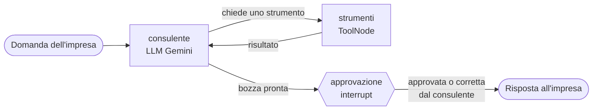

# 💶 Agente AI per la Finanza Agevolata

Agente AI che aiuta uno studio di consulenza a rispondere alle imprese che chiedono
quali **bandi e contributi a fondo perduto** possono ottenere.
L'agente cerca i bandi compatibili, calcola i contributi e crea promemoria sulle scadenze,
ma **nessuna risposta arriva all'impresa senza l'approvazione di un consulente** (human-in-the-loop).

> ⚠️ **Progetto dimostrativo.** I bandi sono inventati e i calcoli semplificati:
> non è una consulenza reale e non va usato per decisioni vere.

## Il problema

Gli studi di consulenza passano molte ore a rispondere a richieste ripetitive
("che bandi ci sono per la mia azienda?", "quanto posso ottenere?") e rischiano di
perdere bandi in scadenza. Un chatbot generico però può inventarsi requisiti o importi.

## La soluzione: l'LLM decide, il codice calcola, l'umano approva

- **L'LLM (Gemini)** capisce la richiesta in linguaggio naturale e decide quali strumenti usare.
- **Gli strumenti** sono codice Python deterministico e testabile: requisiti, percentuali,
  massimali e urgenza non vengono mai "stimati" dal modello.
- **Il consulente** legge ogni bozza e può approvarla o correggerla prima dell'invio.
  L'approvazione è garantita dalla struttura del grafo, non dal prompt.

## Architettura



| Strumento | Cosa fa | Tipo |
|---|---|---|
| `cerca_bandi` | trova i bandi aperti compatibili con regione, dimensione e settore; segnala quelli urgenti | sola lettura |
| `calcola_contributo` | calcola il contributo (percentuale, spesa minima, massimale, scadenza) | sola lettura |
| `crea_promemoria` | registra una scadenza nell'agenda dello studio | azione |

**Tecnologie:** Python · LangGraph (grafo, checkpointer, `interrupt`) · LangChain (tool calling) ·
Gemini API · Streamlit

## Struttura

```
agente.py       grafo LangGraph: nodi, frecce, approvazione del consulente + chat da terminale
strumenti.py    i 3 strumenti (tool) chiamati dall'agente
dati_finti.py   bandi inventati usati dalla demo
app.py          interfaccia web Streamlit (chat impresa + pannello consulente)
```

## Come provarlo

Serve Python 3.12 e una chiave API gratuita di Gemini ([Google AI Studio](https://aistudio.google.com/apikey)).

```bash
python -m venv .venv
.venv\Scripts\activate          # su Mac/Linux: source .venv/bin/activate
pip install -r requirements.txt
copy .env.example .env          # poi inserisci la tua chiave nel file .env
```

Interfaccia web:

```bash
streamlit run app.py
```

Oppure chat da terminale:

```bash
python agente.py
```

Esempio di conversazione: *"Siamo la Rossi Srl, piccola impresa di manifattura a Palermo. Che bandi ci sono?"*
→ *"Con DIGI-PMI spenderemmo 8.000 euro, quanto prendiamo?"* → *"Create un promemoria per DIGI-PMI"*.

## Scelte di progetto

- **Errori come informazioni:** se l'LLM passa un bando inesistente, lo strumento restituisce
  un errore leggibile invece di andare in crash, e il modello lo comunica senza inventare cifre.
- **Memoria per pratica:** ogni conversazione ha un `thread_id` separato, così il contesto
  di un cliente non si mescola con quello di un altro.
- **Modello intercambiabile:** il modello si sceglie nel file `.env`; grazie a LangChain
  passare a un altro provider o a un modello locale richiede poche righe.
- **Segreti fuori dal codice:** la chiave API sta solo nel file `.env`, escluso da git.

## Prossimi passi

- [ ] Approvazione **prima** degli strumenti con effetti (es. `crea_promemoria`), non solo del messaggio finale
- [ ] RAG con Qdrant sui testi di bandi pubblici reali
- [ ] API FastAPI, Docker e deploy online
- [ ] Test automatici (pytest) sugli strumenti
- [ ] Server MCP che espone gli strumenti
- [ ] Modello locale (Ollama) per tenere i dati dentro lo studio
- [ ] Monitoraggio di chiamate, tempi e costi dell'LLM

---
Progetto personale di Paolo Caldovino, sviluppato con l'aiuto di Claude (Anthropic) come assistente alla programmazione.
